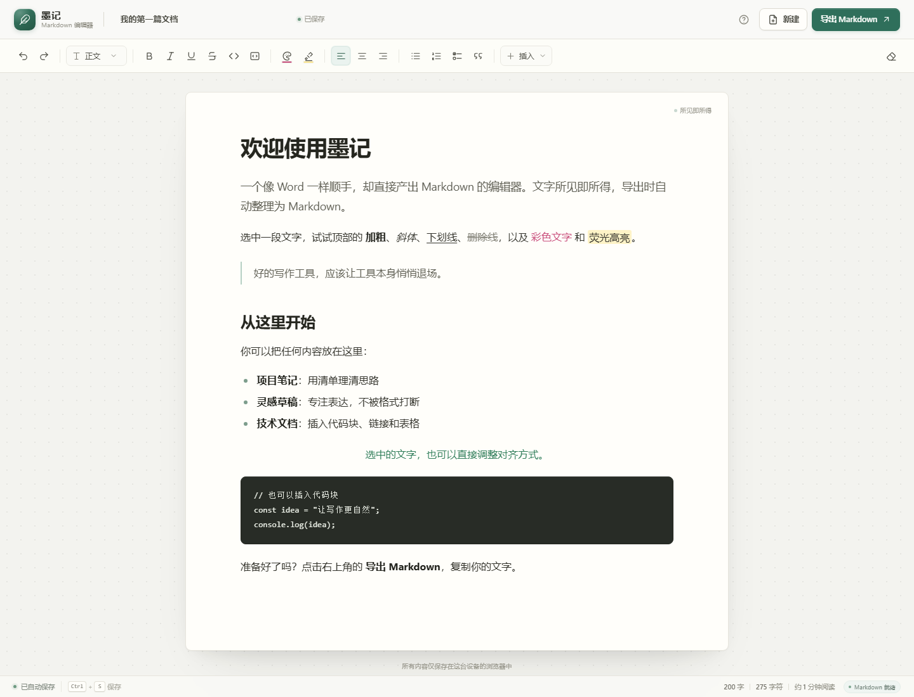

# 墨记 · 富文本 Markdown 编辑器

一款所见即所得的中文 Markdown 编辑器。像 Word 一样选中文字、点击工具栏排版，导出时自动整理成 Markdown，方便直接粘贴到 GitHub、Typora、Obsidian、飞书文档等地方。

无需联网、无需账号、没有后端；所有草稿只保存在当前浏览器的本地存储中。

[在线体验](https://liqirui1145.github.io/moji-mdeditor/) · [GitHub 源码](https://github.com/liqirui1145/moji-mdeditor)



## 立即使用

直接双击打开 **`墨记Markdown编辑器.html`** 即可。这是一个把 CSS、JavaScript 全部内联进去的单文件版本，可以单独复制、移动或发给别人。

如果你想修改源码，请打开 `index.html`，并保证 `styles.css`、`app.js`、`favicon.svg` 与它放在同一目录。

推荐使用最新版 Chrome 或 Edge。Safari / Firefox 也能打开，但个别富文本命令的细节可能有差异。

## 能做什么

- **文字样式**：加粗、斜体、下划线、删除线、行内代码。
- **多颜色文字**：12 种常用文字颜色、12 种荧光高亮、自定义取色，并可将颜色恢复为默认。
- **段落样式**：正文、标题 1–3、引用、代码块。
- **对齐**：左对齐、居中、右对齐。
- **列表**：无序列表、有序列表、可勾选的任务清单；支持缩进、嵌套。
- **插入**：链接、网络图片、表格、分割线。
- **表格工具**：点击表格后，工具栏下方会出现快捷操作，可增删行列、删除表格；表格内按 `Tab` 跳到下一个单元格。
- **复制 / 下载**：导出窗口展示生成的 Markdown，可一键复制或下载 `.md` 文件。
- **自动保存**：编辑内容与文档标题自动保存在浏览器本地，刷新页面不丢失。
- **字数统计**：中文按字、英文按词统计，并估算阅读时间。
- **干净的写作界面**：纸张式编辑区、实时工具栏状态、响应式布局，手机上也能够使用。
- **基础安全处理**：从网页或 Word 粘贴富文本时会过滤脚本、危险链接和事件属性。

## Markdown 导出说明

- 标准语法会转换为原生 Markdown：标题、加粗、斜体、删除线、列表、任务清单、引用、链接、图片、表格、代码围栏。
- 下划线、字体颜色、高亮和对齐在 Markdown 中没有对应的原生语法，因此会以少量内嵌 HTML 保留效果（例如 `<u>`、`<span style="color:…">`、`<p align="center">`）。
- 导出窗口右上角的 **保留富文本样式** 开关默认开启。关闭后会去掉颜色、下划线和段落对齐，输出更纯净的 Markdown。
- 顶部文档标题只用于下载 `.md` 文件时的文件名，不会自动写入正文，避免和正文标题重复。

示例导出：

```markdown
## 本周计划

这里有 **重点**、*想法*、<u>下划线</u> 和 <span style="color: #b4463e">彩色文字</span>。

- [x] 完成编辑器
- [ ] 整理使用说明

| 事项 | 状态 |
| --- | --- |
| 发布初版 | 进行中 |
```

## 快捷键

| 操作 | 快捷键 |
| --- | --- |
| 加粗 / 斜体 / 下划线 | `Ctrl / ⌘ + B` / `I` / `U` |
| 添加链接 | `Ctrl / ⌘ + K` |
| 标题 1 / 2 / 3 | `Ctrl / ⌘ + Alt + 1 / 2 / 3` |
| 正文 | `Ctrl / ⌘ + Alt + 0` |
| 有序 / 无序列表 | `Ctrl / ⌘ + Shift + 7 / 8` |
| 保存草稿 | `Ctrl / ⌘ + S` |
| 导出 Markdown | `Ctrl / ⌘ + Shift + E` |
| 撤销 / 重做 | `Ctrl / ⌘ + Z` / `Ctrl / ⌘ + Shift + Z`（或 `Ctrl + Y`） |
| 关闭菜单 / 弹窗 | `Esc` |
| 列表缩进 / 反缩进 | 在列表中按 `Tab` / `Shift + Tab` |
| 跳转表格单元格 | 在表格内按 `Tab` |
| 新标签页打开链接 | 按住 `Ctrl / ⌘` 单击链接 |

## 文件结构

```text
markdown-editor/
├─ 墨记Markdown编辑器.html   # 单文件离线版，直接打开
├─ index.html               # 开发版入口
├─ styles.css               # 界面与排版样式
├─ app.js                   # 编辑器逻辑
├─ favicon.svg              # 站点图标
├─ preview.png              # 界面预览
└─ README.md
```

## 数据与隐私

草稿存放在浏览器的 `localStorage` 中，键名为：

```text
moji-rich-markdown-editor:draft:v1
```

清除浏览器站点数据会一并清除草稿。编辑器本身不会上传任何内容；如果你插入网络图片，浏览器会直接向该图片地址发起请求。

## 开发说明

这是一个无构建、无框架的纯前端项目，JS 内部已按功能分区，包括选区与工具栏、粘贴清理、Markdown 序列化、弹窗管理、表格操作等。修改 `app.js` 或 `styles.css` 后刷新页面即可看到效果；若要重新生成单文件版本，可将 `styles.css` 与 `app.js` 分别内联进 `index.html`。
